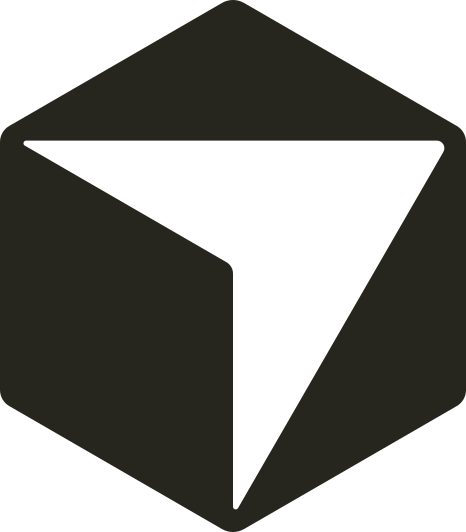
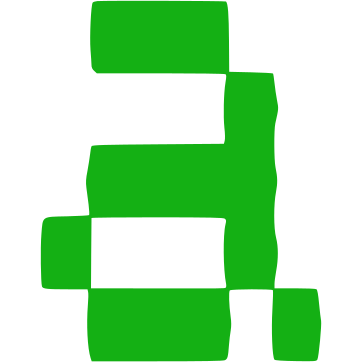
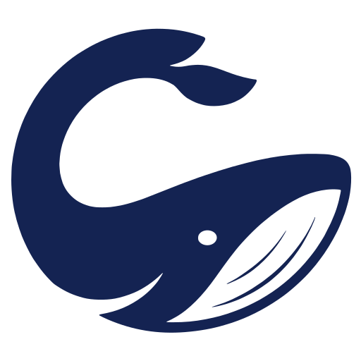

<div align="center">

### Orchestrator.inc

#### Planifica, ejecuta y supervisa agentes de programación desde un solo lugar.

[](https://github.com/OrchestratorInc/agent-orchestrator/stargazers)

[](https://github.com/OrchestratorInc/agent-orchestrator/releases/latest)
[](https://github.com/OrchestratorInc/agent-orchestrator/releases)
[](../LICENSE)
[](https://x.com/useOrchestrator)
[](https://discord.com/invite/UZv7JjxbwG)

Orchestrator.inc (antes Agent Orchestrator, AO; antes github.com/ComposioHQ/agent-orchestrator) es un orquestador de código abierto (Apache-2.0) para Claude Code, Codex y más de 35 agentes de programación. Ejecuta agentes en paralelo, cada uno en su propio worktree y rama de git aislados. Un agente orquestador de proyecto planifica objetivos más amplios y lanza agentes worker centrados en tareas concretas. Un ciclo autónomo de pull requests devuelve los fallos de CI y los comentarios de revisión al agente responsable del cambio. AO se distribuye como aplicación de escritorio para macOS, Windows y Linux, con apps complementarias para iPhone, iPad y Android para que puedas seguir y dirigir a tus agentes desde el teléfono.

Asigna a cada tarea de programación su propio agente, espacio de trabajo y ciclo de feedback.<br />
Planifica y delega objetivos más amplios con un orquestador que conoce tu proyecto.<br />
Sigue a cada worker, pull request, ejecución de CI y revisión en un Kanban en vivo.

[**Descargar Orchestrator.inc**](#instalación) &nbsp;&bull;&nbsp; [Documentación](https://docs.orchestrator.inc) &nbsp;&bull;&nbsp; [Versiones](https://github.com/OrchestratorInc/agent-orchestrator/releases) &nbsp;&bull;&nbsp; [Contribuir](../CONTRIBUTING.md) &nbsp;&bull;&nbsp; [Discord](https://discord.com/invite/UZv7JjxbwG)

[English](../README.md) · [简体中文](README.zh-CN.md) · [日本語](README.ja.md) · [한국어](README.ko.md) · **Español** · [Français](README.fr.md) · [Deutsch](README.de.md) · [Português (Brasil)](README.pt-BR.md)

<br />


</div>

## Un espacio de trabajo para el desarrollo con agentes

Un agente de programación puede encargarse de una tarea. Cuando varios trabajan en paralelo dentro de un proyecto, el reto cambia: decidir qué importa, dividir bien el trabajo, dar el contexto adecuado a cada agente, evitar colisiones entre ramas y acompañar cada cambio hasta la revisión y la integración.

Orchestrator.inc es un espacio de trabajo local de escritorio creado para ese reto. Añade un repositorio y crea una sesión de worker con el agente, el modelo y la interfaz que mejor se adapten a la tarea. Para trabajo respaldado por Git, Orchestrator.inc asigna al worker su propia rama y su propio worktree. La tarea, la conversación, el terminal, los archivos modificados, la vista previa del navegador, el pull request, la CI y el estado de revisión permanecen vinculados a esa sesión de principio a fin.

Detrás de la aplicación de escritorio, el daemon local de Orchestrator.inc observa la actividad de los agentes y el estado del control de versiones. El resultado es una vista compartida y en vivo del proyecto, en lugar de una colección de terminales, ramas y pestañas del navegador desconectadas.


## Los workers ejecutan tareas bien definidas

Un worker es la unidad de ejecución de Orchestrator.inc: una tarea, un agente de programación y un espacio de trabajo aislado. Usa **New task** cuando el trabajo ya esté claro. Describe el resultado, elige un agente y un modelo, adjunta los archivos pertinentes y trabaja con el agente desde el Chat estructurado o desde su interfaz de terminal nativa.

Puedes abrir un worker en cualquier momento para continuar la conversación, conectarte a su terminal, inspeccionar sus cambios, usar su navegador aislado, revisar su pull request o devolver feedback de CI y revisión al mismo agente. Así, cada tarea se entiende por sí sola y el trabajo en paralelo no termina mezclado en un único contexto compartido.


## El orquestador planifica a escala de proyecto

El orquestador del proyecto es el agente permanente de planificación y coordinación de Orchestrator.inc. Trabaja un nivel por encima de las tareas individuales: la dirección del producto, la estrategia técnica, las prioridades y la secuencia de trabajo en todo el repositorio.

Usa el orquestador para explorar una idea antes de implementarla, desarrollar enfoques de producto y técnicos, sopesar ventajas, costes y compromisos, detectar trabajo de alto impacto y convertir un objetivo ambiguo en un plan concreto. Su conversación, ligada al proyecto, conserva objetivos, decisiones, restricciones y razonamientos anteriores. Combina ese historial de planificación con el contexto del repositorio y el estado actual de Orchestrator.inc, incluidos los workers activos, sus responsables, los pull requests, la CI y las revisiones. De este modo, la planificación se mantiene anclada tanto en el proyecto como en el trabajo que ya está en marcha.

Cuando un plan está listo para ejecutarse, el orquestador puede dividirlo en tareas bien definidas, iniciar o redirigir workers, entregar a cada uno el contexto pertinente, seguir su progreso y coordinar el trabajo posterior. El orquestador se ocupa de la planificación y la delegación. Los workers se ocupan de la implementación, las pruebas, los commits y los pull requests.


## El Kanban hace que el sistema sea comprensible

Cada worker aparece en el mismo tablero en vivo, tanto si lo iniciaste desde **New task** como si lo delegó el orquestador. Orchestrator.inc determina la posición de cada tarjeta a partir de datos de la sesión, el pull request, la CI y la revisión. Así, el Kanban se convierte en una vista operativa del proyecto:

- **Working:** workers que están implementando activamente o listos para recibir otra instrucción
- **Needs you:** sesiones bloqueadas, datos pendientes, CI fallida, cambios solicitados o señales perdidas
- **In review:** pull requests abiertos o en borrador a la espera de comprobaciones o revisiones
- **Ready to merge:** trabajo aprobado o listo para integrar; las sesiones ya integradas siguen visibles hasta que se archivan

Cada tarjeta reúne la tarea, el agente, la rama, la actividad, el pull request y el estado. Ábrela para inspeccionar la conversación o el terminal, los archivos modificados, el resumen del PR, las revisiones y la vista previa. El tablero muestra qué avanza, qué está bloqueado y dónde tendrá más impacto tu atención.


## Un solo flujo de trabajo, de la idea a la integración

1. **Empieza en el nivel adecuado.** Entrega una tarea clara directamente a un worker o desarrolla un objetivo mayor con el orquestador del proyecto y deja que dé forma al plan.
2. **Delega trabajo concreto.** Inicia los workers tú mismo o deja que el orquestador los cree con el contexto y la responsabilidad que necesitan.
3. **Trabaja de forma aislada.** Cada worker respaldado por Git recibe su propia rama y su propio worktree. Los workers Scratch reciben directorios sin rama gestionados por Orchestrator.inc.
4. **Supervisa el estado en vivo.** Orchestrator.inc sigue la actividad de los agentes, los pull requests, la CI, el feedback de revisión y los conflictos de integración, y refleja esos datos en el Kanban.
5. **Cierra el ciclo de feedback.** Inspecciona cualquier worker directamente, toma decisiones de proyecto con el orquestador y devuelve los fallos accionables o comentarios de revisión al agente responsable.

Orchestrator.inc funciona con los agentes de programación y el flujo de control de versiones que ya utilizas. Los agentes mantienen sus fortalezas propias. Orchestrator.inc aporta el contexto del proyecto, la ejecución aislada, la coordinación y la vista operativa que les permiten funcionar como un sistema.

## Funciones destacadas

- **Un agente orquestador que planifica y delega.** El orquestador de cada proyecto convierte un objetivo en un plan, lanza workers con el contexto justo y sigue sus pull requests. Ábrelo desde la barra lateral o con ⌘⇧O en macOS y Ctrl+Shift+G en Windows y Linux.
- **Un ciclo autónomo de pull requests.** Los fallos de CI, los comentarios de revisión y los conflictos de merge vuelven al worker responsable del cambio.
- **Revisión de AO integrada.** Un agente revisor exigente, en cualquier harness compatible con revisiones, revisa el pull request de un worker y deja un comentario en línea por cada cambio que exige. Esos comentarios vuelven al worker.
- **37 agentes de programación, elegidos por proyecto.** Elige agentes distintos para los workers, el orquestador y los revisores. Usa el Chat estructurado o la interfaz de terminal nativa del agente y cambia entre ambos cuando el harness lo permita.
- **Un chat que va a tu ritmo.** Tab acepta el siguiente mensaje sugerido. En Developer mode, los chats laterales del inspector ofrecen una vista previa de las bifurcaciones nativas de conversación cuando el proveedor las admite.
- **Artefactos.** Los agentes pueden entregar informes en Markdown, SVG, imágenes y páginas HTML en lugar de un pull request. Se abren renderizados en un visor editable a pantalla completa con historial de versiones y restauración, y los más recientes aparecen en las tarjetas del Kanban.
- **Automatizaciones.** Programa prompts recurrentes y reutiliza instrucciones de proyecto y comandos de shell como Cues.
- **Escritorio y móvil.** Apps de escritorio para macOS, Windows y Linux, además de apps para iPhone, iPad y Android que gestionan varios equipos, inician sesiones y envían notificaciones push. En macOS, Stay Awake mantiene el equipo accesible, incluso con la tapa del MacBook cerrada en los modelos compatibles.
- **Cuentas y configuración.** Instala y actualiza las CLI de los agentes desde Settings, usa varias cuentas de suscripción de Codex y prueba las cuentas por carpeta de Claude Code y Codex como vista previa en Developer mode. Elige entre 20 temas de color claros y oscuros.

<table>
  <tr>
    <td width="36%" valign="middle">
      <h3>Pull requests y revisiones con agentes</h3>
      <p>Mantén junto al worker la CI, la capacidad de integración, el estado de los revisores y las revisiones interactivas con agentes. Después, devuelve los cambios solicitados al mismo responsable.</p>
    </td>
    <td width="64%">
      
    </td>
  </tr>
  <tr>
    <td width="36%" valign="middle">
      <h3>Navegador controlable por agentes</h3>
      <p>Previsualiza e inspecciona la aplicación local de un worker junto a su interfaz. Los perfiles del navegador están aislados por worker para que las tareas de UI en paralelo no compartan estado.</p>
    </td>
    <td width="64%">
      
    </td>
  </tr>
  <tr>
    <td width="36%" valign="middle">
      <h3>Interfaces nativas, un solo supervisor</h3>
      <p>Usa Chat estructurado o la interfaz de terminal nativa del agente mientras Orchestrator.inc mantiene el contexto, el estado del workspace y el feedback en un solo lugar.</p>
    </td>
    <td width="64%">
      
    </td>
  </tr>
</table>

<a id="mobile-and-cross-device"></a>

## Móvil y entre dispositivos

Orchestrator.inc tiene apps complementarias para iPhone, iPad y Android:

- [Descárgala en el App Store](https://apps.apple.com/app/ao-mobile/id6792552173) (iPhone y iPad)
- [Disponible en Google Play](https://play.google.com/store/apps/details?id=aoagents.dev) (Android)

El teléfono es un mando a distancia para la app de escritorio. Tus repositorios, worktrees y agentes de programación siguen ejecutándose en tu propio equipo, y el teléfono se conecta a ese equipo, no a una copia alojada de tu código. Para emparejarlo, abre **Settings → Connect Mobile** en la app de escritorio, elige **Generate** y escanea el código QR con la app móvil. Si no puedes escanearlo, introduce a mano la dirección, el puerto y la contraseña de conexión.

Cómo llega el teléfono a tu equipo:

- **Misma red (LAN):** funciona sin configuración adicional en una red Wi-Fi de confianza en casa o en la oficina. Esta conexión es HTTP sin cifrar protegido por la contraseña de conexión, así que no la uses en redes que no sean de confianza.
- **Tailscale:** cuando el equipo está en una tailnet, el código QR también incluye su dirección de Tailscale para teléfonos de la misma tailnet. El iPhone y el iPad no pueden usarla, porque iOS bloquea las conexiones sin cifrar a direcciones de Tailscale. La app de Android permite esta conexión, pero aún no se ha verificado en un dispositivo Android físico. Para una vía probada fuera de casa, usa la opción HTTPS de abajo.
- **Túnel HTTPS gestionado:** Connect Mobile ejecuta `cloudflared` (incluido en la app de macOS, instalable con un clic en Windows y Linux) para añadir una dirección HTTPS que puedes usar fuera de casa desde cualquier dispositivo. En esa ruta, Cloudflare termina el TLS.

El teléfono prueba todas las direcciones del código QR y usa la primera que responde. La API principal del escritorio nunca sale de `127.0.0.1`. Connect Mobile es un listener aparte que está desactivado por defecto, exige la contraseña de conexión y se puede desactivar o cambiar de contraseña en cualquier momento.

Desde el teléfono puedes abrir cualquier proyecto y worker, usar el Chat estructurado o la interfaz de terminal del agente, iniciar sesiones nuevas, responder aprobaciones y preguntas, cambiar de agente y de modelo, dictar por voz, adjuntar archivos, seguir pull requests, revisiones y ejecuciones de revisores, y recibir notificaciones push.

Otra app de escritorio de Orchestrator.inc también puede conectarse a este equipo como host remoto. Ejecuta `ao remote-host` en este equipo. En el otro, activa **Settings → General → Developer mode** y usa **Settings → Remote hosts → Add host**. Consulta [Remote access and mobile](https://docs.orchestrator.inc/configuration/remote-access) para ver la configuración paso a paso, el modelo de seguridad y la resolución de problemas.

**Orchestrator Cloud ya está disponible en la app de escritorio** (activa **Settings → General → Developer mode** y después **Cloud**). Elige **Sign in to AO Cloud** y ejecuta agentes en la nube, en sandboxes alojados en lugar de en tu equipo. Cualquiera puede iniciar sesión y empezar. Las sesiones en la nube se ejecutan en sandboxes remotos que pueden tardar en arrancar o perder el trabajo sin confirmar, así que haz commit y push a menudo. Consulta la [guía de Cloud](https://docs.orchestrator.inc/guides/cloud) y los [planes](#plans).

<a id="supported-agents"></a>

## Agentes compatibles

Los agentes de programación trabajan en un mismo flujo supervisado. Consulta el [catálogo de capacidades](https://docs.orchestrator.inc/plugins/agents) para ver los agentes y modos actuales.

<table>
  <tr valign="middle">
    <td width="33%" valign="middle" nowrap> &nbsp; <b>Claude Code</b></td>
    <td width="33%" valign="middle" nowrap> &nbsp; <b>Codex</b></td>
    <td width="33%" valign="middle" nowrap><picture><source media="(prefers-color-scheme: dark)" srcset="../frontend/src/renderer/assets/agents/cursor-dark.svg" /></picture> &nbsp; <b>Cursor</b></td>
  </tr>
  <tr valign="middle">
    <td valign="middle" nowrap><picture><source media="(prefers-color-scheme: dark)" srcset="../frontend/src/renderer/assets/agents/opencode-dark.svg" /></picture> &nbsp; <b>opencode</b></td>
    <td valign="middle" nowrap> &nbsp; <b>Aider</b></td>
    <td valign="middle" nowrap><picture><source media="(prefers-color-scheme: dark)" srcset="../frontend/src/renderer/assets/agents/copilot-dark.svg" /></picture> &nbsp; <b>GitHub Copilot</b></td>
  </tr>
  <tr valign="middle">
    <td valign="middle" nowrap><picture><source media="(prefers-color-scheme: dark)" srcset="../frontend/src/renderer/assets/agents/grok-dark.svg" /></picture> &nbsp; <b>Grok</b></td>
    <td valign="middle" nowrap><picture><source media="(prefers-color-scheme: dark)" srcset="../frontend/src/renderer/assets/agents/kimi-dark.svg" /></picture> &nbsp; <b>Kimi</b></td>
    <td valign="middle" nowrap> &nbsp; <b>Pi</b></td>
  </tr>
  <tr valign="middle">
    <td valign="middle" nowrap><picture><source media="(prefers-color-scheme: dark)" srcset="../frontend/src/renderer/assets/agents/amp-dark.svg" /></picture> &nbsp; <b>Amp</b></td>
    <td valign="middle" nowrap><picture><source media="(prefers-color-scheme: dark)" srcset="../frontend/src/renderer/assets/agents/auggie-dark.svg" /></picture> &nbsp; <b>Auggie</b></td>
    <td valign="middle" nowrap><picture><source media="(prefers-color-scheme: dark)" srcset="../frontend/src/renderer/assets/agents/droid-dark.svg" /></picture> &nbsp; <b>Droid</b></td>
  </tr>
  <tr valign="middle">
    <td valign="middle" nowrap> &nbsp; <b>Crush</b></td>
    <td valign="middle" nowrap><picture><source media="(prefers-color-scheme: dark)" srcset="../frontend/src/renderer/assets/agents/cline-dark.svg" /></picture> &nbsp; <b>Cline</b></td>
    <td valign="middle" nowrap><picture><source media="(prefers-color-scheme: dark)" srcset="../frontend/src/renderer/assets/agents/goose-dark.svg" /></picture> &nbsp; <b>Goose</b></td>
  </tr>
  <tr valign="middle">
    <td valign="middle" nowrap><picture><source media="(prefers-color-scheme: dark)" srcset="../frontend/src/renderer/assets/agents/qwen-dark.svg" /></picture> &nbsp; <b>Qwen</b></td>
    <td valign="middle" nowrap><picture><source media="(prefers-color-scheme: dark)" srcset="../frontend/src/renderer/assets/agents/continue-dark.svg" /></picture> &nbsp; <b>Continue</b></td>
    <td valign="middle" nowrap><picture><source media="(prefers-color-scheme: dark)" srcset="../frontend/src/renderer/assets/agents/devin-dark.svg" /></picture> &nbsp; <b>Devin</b></td>
  </tr>
  <tr valign="middle">
    <td valign="middle" nowrap> &nbsp; <b>Kiro</b></td>
    <td valign="middle" nowrap><picture><source media="(prefers-color-scheme: dark)" srcset="../frontend/src/renderer/assets/agents/kilocode-dark.svg" /></picture> &nbsp; <b>Kilo Code</b></td>
    <td valign="middle" nowrap> &nbsp; <b>Vibe</b></td>
  </tr>
  <tr valign="middle">
    <td valign="middle" nowrap> &nbsp; <b>Muse</b></td>
    <td valign="middle" nowrap> &nbsp; <b>Agy</b></td>
    <td valign="middle" nowrap><picture><source media="(prefers-color-scheme: dark)" srcset="../docs/assets/readme/agents/autohand-stacked-dark.png" /></picture> <b>Autohand</b></td>
  </tr>
  <tr valign="middle">
    <td valign="middle" nowrap> &nbsp; <b>Kimchi</b></td>
    <td valign="middle" nowrap> &nbsp; <b>Prime Agent</b></td>
    <td valign="middle" nowrap> &nbsp; <b>OMP</b></td>
  </tr>
  <tr valign="middle">
    <td valign="middle" nowrap><picture><source media="(prefers-color-scheme: dark)" srcset="../frontend/src/renderer/assets/agents/fx-dark.svg" /></picture> &nbsp; <b>fx</b></td>
    <td valign="middle" nowrap><picture><source media="(prefers-color-scheme: dark)" srcset="../frontend/src/renderer/assets/agents/unreal-agent-dark.png" /></picture> &nbsp; <b>Unreal Agent</b></td>
    <td valign="middle" nowrap> &nbsp; <b>MiMo Code</b></td>
  </tr>
  <tr valign="middle">
    <td valign="middle" nowrap> &nbsp; <b>Gemini CLI</b></td>
    <td valign="middle" nowrap><picture><source media="(prefers-color-scheme: dark)" srcset="../frontend/src/renderer/assets/agents/deepseek-harness-dark.svg" /></picture> &nbsp; <b>DeepSeek</b></td>
    <td valign="middle" nowrap><picture><source media="(prefers-color-scheme: dark)" srcset="../frontend/src/renderer/assets/agents/opencode-dark.svg" /></picture> &nbsp; <b>OpenCode 2</b></td>
  </tr>
  <tr valign="middle">
    <td valign="middle" nowrap><picture><source media="(prefers-color-scheme: dark)" srcset="../frontend/src/renderer/assets/agents/codewhale-dark.svg" /></picture> &nbsp; <b>Codewhale</b></td>
    <td valign="middle" nowrap><picture><source media="(prefers-color-scheme: dark)" srcset="../frontend/src/renderer/assets/agents/command-code-dark.svg" /></picture> &nbsp; <b>Command Code</b></td>
    <td valign="middle" nowrap><picture><source media="(prefers-color-scheme: dark)" srcset="../frontend/src/renderer/assets/agents/openhands-dark.svg" /></picture> &nbsp; <b>OpenHands</b></td>
  </tr>
  <tr valign="middle">
    <td valign="middle" nowrap> &nbsp; <b>memcode</b></td>
    <td valign="middle" nowrap></td>
    <td valign="middle" nowrap></td>
  </tr>
</table>

[Consulta las guías de configuración de agentes →](https://docs.orchestrator.inc/plugins/agents)

**Usa la interfaz que mejor encaje en cada momento: el Chat estructurado o la interfaz de terminal nativa del agente.**

## Instalación

Descarga la última aplicación de escritorio de Orchestrator.inc para tu plataforma. Orchestrator.inc comprueba automáticamente si hay actualizaciones.

| Plataforma            | Descarga                                                                                                                       |
| --------------------- | ------------------------------------------------------------------------------------------------------------------------------ |
| macOS (Apple silicon) | [Descargar](https://github.com/OrchestratorInc/agent-orchestrator/releases/latest/download/agent-orchestrator-darwin-arm64.dmg)   |
| macOS (Intel)         | [Descargar](https://github.com/OrchestratorInc/agent-orchestrator/releases/latest/download/agent-orchestrator-darwin-x64.dmg)     |
| Windows               | [Descargar](https://github.com/OrchestratorInc/agent-orchestrator/releases/latest/download/agent-orchestrator-win32-x64.exe)      |
| Linux (AppImage)      | [Descargar](https://github.com/OrchestratorInc/agent-orchestrator/releases/latest/download/agent-orchestrator-linux-x64.AppImage) |
| Linux (Debian/Ubuntu) | [Descargar](https://github.com/OrchestratorInc/agent-orchestrator/releases/latest/download/agent-orchestrator-linux-x64.deb)      |
| Linux (Fedora/RHEL)   | [Descargar](https://github.com/OrchestratorInc/agent-orchestrator/releases/latest/download/agent-orchestrator-linux-x64.rpm)      |

Abre Orchestrator.inc y selecciona el repositorio que quieres que Orchestrator.inc gestione. La aplicación de escritorio ejecuta el daemon por ti, así que no necesitas ninguna CLI. Consulta la [guía de instalación](https://docs.orchestrator.inc/installation) para configurar las CLI de los agentes y resolver problemas.

<a id="plans"></a>

## Planes

El uso local es gratuito: agentes locales ilimitados con cualquier harness compatible, además del orquestador, los workers y las revisiones de PR. Los agentes locales no tienen límites de plan. Los planes de pago añaden agentes de AO Cloud, y pronto llegará un relay en la nube para conectarse entre dispositivos.

| Plan | Precio | Incluye |
| --- | --- | --- |
| **Free** | $0 | Agentes locales ilimitados en tu equipo. Orquestador, workers y revisiones de PR. Conexión en la misma red o desde cualquier lugar con tu propio Tailscale o el túnel HTTPS gestionado. Sin agentes en la nube. |
| **Starter** | $20/mes | Todo lo de Free, más agentes en la nube. Los agentes en la nube siguen trabajando mientras tu equipo está en reposo, con pull requests, correcciones de CI y revisiones en la nube. 1 proyecto en la nube y 1 agente en la nube simultáneo. Próximamente: un relay en la nube para acceder desde cualquier dispositivo. |
| **Pro** | $40/mes | Todo lo de Starter. Usa tu propio despliegue de Coder. 5 proyectos en la nube y 15 agentes en la nube simultáneos. |
| **Enterprise** | Personalizado | Proyectos en la nube y agentes en la nube simultáneos ilimitados, sin límite de horas de sesión, colaboración en agentes en la nube, SSO y gestión de equipos, y soporte prioritario con SLA. |

Los planes se facturan mensualmente; consulta [orchestrator.inc/pricing](https://orchestrator.inc/pricing). Elige o cambia de plan en la app de escritorio, en **Settings → Upgrade**, después de iniciar sesión en AO Cloud. Para Enterprise, usa **Talk to founder** en la misma página o únete a la [lista de espera de Teams & Enterprise](https://orchestrator.inc/waitlist).

## Preguntas frecuentes

### ¿Qué es Orchestrator.inc (Agent Orchestrator, AO)?

Orchestrator.inc, antes Agent Orchestrator (AO), es una app de escritorio y una CLI de código abierto. Ejecuta y supervisa Claude Code, Codex y otros agentes de programación en paralelo, cada uno en su propio worktree de git. También sigue sus pull requests, su CI y sus revisiones.

### ¿Con qué licencia se distribuye?

Apache-2.0. Consulta [LICENSE](../LICENSE).

### ¿Qué agentes de programación son compatibles?

37 harnesses de agentes de programación (más de 35), entre ellos Claude Code, Codex, Cursor, Gemini CLI, GitHub Copilot, opencode, Aider, Amp, Droid, Goose, Cline y Kimi. Consulta la tabla de [agentes compatibles](#supported-agents) de arriba. La compatibilidad como worker, en Chat y como revisor varía según el agente.

### ¿En qué plataformas funciona?

La app de escritorio funciona en macOS (Apple silicon e Intel), Windows y Linux (AppImage, `.deb` y `.rpm`).

### ¿Hay una app móvil?

Sí. Orchestrator.inc está en el [App Store](https://apps.apple.com/app/ao-mobile/id6792552173) para iPhone y iPad y en [Google Play](https://play.google.com/store/apps/details?id=aoagents.dev) para Android. La app se empareja con tu escritorio a través de tu red local o de un túnel HTTPS gestionado. También se ofrecen direcciones de Tailscale, pero el iPhone y el iPad no pueden usarlas y en Android aún no se ha verificado en un dispositivo. Consulta [Móvil y entre dispositivos](#mobile-and-cross-device).

### ¿Es gratis?

Sí. La app local es gratuita: la app de escritorio, la CLI y las apps móviles no cuestan nada, y el código fuente es abierto bajo Apache-2.0. Usas tus propias suscripciones o claves de API de los agentes de programación. Los planes de pago de AO Cloud empiezan en $20/mes (Starter); Pro cuesta $40/mes y Enterprise tiene precio personalizado. Consulta los [planes](#plans). Los equipos y las empresas pueden unirse a la [lista de espera de Teams & Enterprise](https://orchestrator.inc/waitlist).

### ¿Es el mismo proyecto que `ComposioHQ/agent-orchestrator`?

Sí. El proyecto estaba antes en `github.com/ComposioHQ/agent-orchestrator` y ahora está en [github.com/OrchestratorInc/agent-orchestrator](https://github.com/OrchestratorInc/agent-orchestrator). Se distribuye bajo la licencia Apache-2.0.

## Informar de un bug

[Abre un informe de bug](https://github.com/OrchestratorInc/agent-orchestrator/issues/new?template=bug_report.yml) desde tu propia cuenta de GitHub. Bastan unas frases, escritas con tus propias palabras, sobre lo que hiciste y lo que salió mal. Si los tienes, añade lo que esperabas, los pasos para reproducirlo, tu versión de Orchestrator.inc y tu sistema operativo, o una captura de pantalla. Estos datos ayudan, pero no son requisitos.

Un agente de programación local puede ayudarte a precisar el informe y recopilar pruebas con la [skill de triaje de bugs](https://github.com/OrchestratorInc/agent-orchestrator/blob/main/.agents/skills/bug-triage/SKILL.md). Mantén el contenido del issue centrado en tus observaciones. Coloca los registros, extractos de la base de datos y notas de investigación recopilados por el agente en archivos adjuntos claramente identificados. Revisa el borrador antes de enviarlo desde tu propia cuenta. No pidas a un bot que presente issues en tu nombre; la atribución del informe es importante.

Si necesitas ayuda para describir un problema, únete al [canal de triaje de bugs en Discord](https://discord.com/channels/1476302178913357958/1491735678156013588). Consulta la [guía para contribuir](../CONTRIBUTING.md#bugs-and-features) para obtener más detalles.

## Desarrollar y contribuir

Las contribuciones son bienvenidas en código, documentación, triaje, ejemplos y pruebas.

```bash
git clone https://github.com/OrchestratorInc/agent-orchestrator.git
cd agent-orchestrator
```

Empieza por la [guía de desarrollo](../docs/development.md), donde encontrarás los requisitos previos, la configuración local y los comandos de prueba. Lee [CONTRIBUTING.md](../CONTRIBUTING.md) antes de abrir un pull request y utiliza [GitHub Issues](https://github.com/OrchestratorInc/agent-orchestrator/issues) para informar de bugs o proponer funciones.

## Documentación

| Documento                                                           | Empieza aquí si necesitas                                                                                |
| ------------------------------------------------------------------- | -------------------------------------------------------------------------------------------------------- |
| [Documentación del producto](https://docs.orchestrator.inc)                | Instalación, configuración de agentes y uso cotidiano del producto.                                      |
| [docs/architecture.md](../docs/architecture.md)                     | Modelo mental del backend, ciclo de vida, persistencia, CDC, derivación del estado y límites del daemon. |
| [docs/backend-code-structure.md](../docs/backend-code-structure.md) | Responsabilidad de los paquetes y ubicación de cada aspecto del backend.                                 |
| [docs/cli/README.md](../docs/cli/README.md)                         | Comportamiento de la CLI y correspondencia con las rutas del daemon.                                     |
| [docs/development.md](../docs/development.md)                       | Requisitos, compilación, pruebas y solución de problemas para desarrollo local.                          |
| [docs/STATUS.md](../docs/STATUS.md)                                 | Qué se distribuye actualmente en `main` y qué sigue en desarrollo.                                       |

## Comunidad

Únete a [Discord](https://discord.com/invite/UZv7JjxbwG) para pedir ayuda y hablar con otros colaboradores, sigue a [@useOrchestrator](https://x.com/useOrchestrator) para conocer las novedades o inicia una conversación en [GitHub Issues](https://github.com/OrchestratorInc/agent-orchestrator/issues).

## Telemetría del producto

Orchestrator.inc recopila métricas de uso y fiabilidad sin contenido de los proyectos. El propietario de un proyecto en GitHub y el nombre de usuario conectado pueden identificar a una persona; la telemetría no es anónima. Desactivarla también detiene el envío de esos datos. [Detalles y controles](../docs/telemetry.md).

## Licencia

Orchestrator.inc está disponible bajo la [licencia Apache 2.0](../LICENSE).
